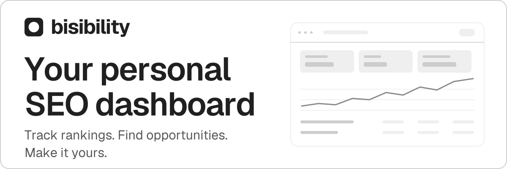
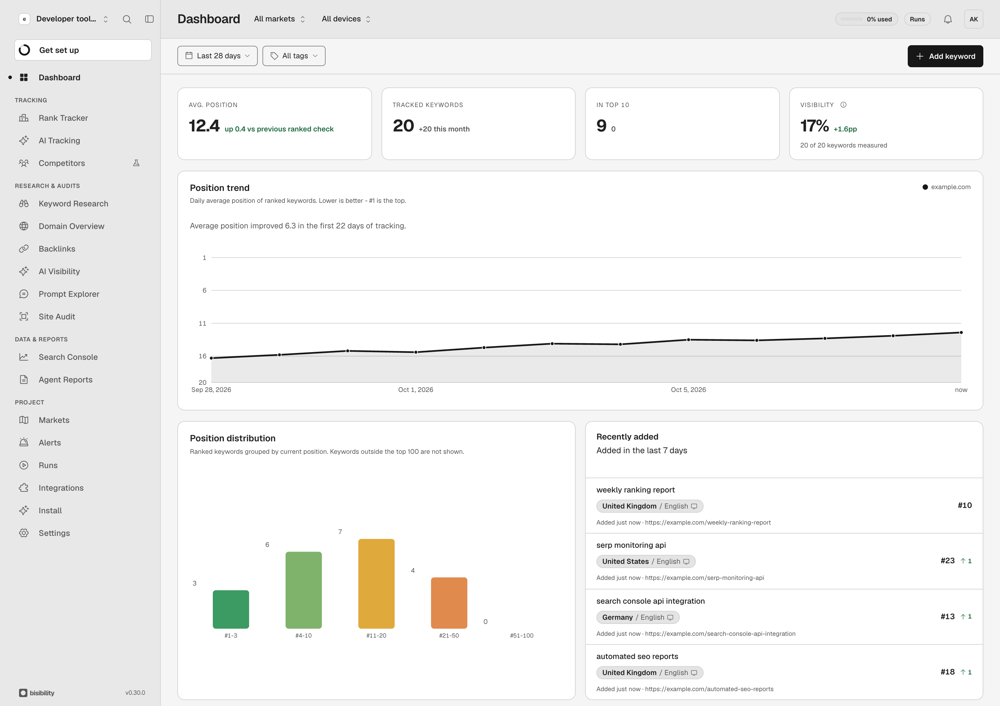

# bisibility

<p>
  
</p>

[](https://bisibility.com)
[](https://demo.bisibility.com)
[](https://bisibility.com/docs)
[](https://discord.gg/HcYpvfn79w)
[](https://x.com/bisibility_com)

[](LICENSE)
[](https://github.com/CorgiCorner/bisibility/releases/latest)
[](https://github.com/CorgiCorner/bisibility/actions/workflows/ci.yml)
[](.github/SECURITY.md)
[](https://bisibility.com/docs/self-hosting/docker)

[](https://bisibility.com/docs/self-hosting)
[](https://bisibility.com/docs/integrations)
[](https://bisibility.com/docs/api/overview)
[](https://bisibility.com/docs/agents)
[](https://bisibility.com/docs/cli)

[](https://bisibility.com/docs/sdks/typescript)
[](https://bisibility.com/docs/sdks/python)
[](https://bisibility.com/docs/sdks/go)
[](https://bisibility.com/docs/api/webhooks)

See what changed in your Google rankings, discover keywords to target, and explore
your backlinks in one place. Self-host with your own data providers, or start with
the hosted service.

**[Live demo](https://demo.bisibility.com)** ·
[Hosted beta](https://bisibility.com/) ·
[Self-host](https://bisibility.com/docs/self-hosting) ·
[Documentation](https://bisibility.com/docs)

## What you can do

- **See which Google rankings changed.** Track ranking URLs and history by market
  and device, schedule checks, set alerts, and compare competitor Share of Voice.
- **Find keywords worth investigating.** Explore suggestions, search volume,
  trends, CPC, difficulty, and intent before choosing what to target.
- **Understand your backlink profile.** Inspect referring domains, new and lost
  links, and link attributes alongside your ranking work.
- **Follow selected AI prompts over time.** Recurring [AI Tracking][ai-tracking]
  retains answers, citations, and comparable history from supported consumer-answer
  sources, model API responses, and Google AI Overview. Source, model, and market
  availability varies; these observations do not cover every AI service or market.

## Choose how to start

| Path | Start here |
| --- | --- |
| **Demo** | Explore the [live app](https://demo.bisibility.com), or run the [local demo quickstart](https://bisibility.com/docs/quickstart) with synthetic data. |
| **Hosted beta** | [Start with the managed service](https://bisibility.com/) and connect your own data providers. The application stack and scheduling are operated for you. |
| **Self-host** | Follow the [production guide](https://bisibility.com/docs/self-hosting) to run the app and keep its history in your PostgreSQL database. Scheduled work also needs the worker and Temporal. |

The local demo is disposable and uses intentionally insecure demo authentication.
Use the production guide for a real deployment. See [deployment options][deployment]
for current hosted beta limits and what each path requires.

## Data providers and costs

Connect your own provider accounts and credentials (BYOK). Google rank checks
support DataForSEO and SerpAPI; keyword, backlink, and domain research use
DataForSEO. AI Tracking uses supported DataForSEO answer and Google AI Overview
sources. Supported configurations are checked before provider work.

Real provider-backed data is not included with the application. Provider usage is
billed directly by your connected provider on both hosted and self-hosted
deployments. Self-hosting has no application subscription or per-keyword license
fee; your infrastructure and provider usage remain separate costs. The hosted
service has [current beta limits][deployment], which may change as the beta
progresses.

Review [provider setup and budget controls](https://bisibility.com/docs/integrations)
and [estimate rank-check costs](https://bisibility.com/rank-tracking-cost-calculator)
before enabling a large schedule. AI Tracking schedules start disabled; running
paid observations or enabling a schedule requires a fresh review and explicit
cost consent. Credentials stay in your self-hosted instance; the hosted service
stores them encrypted.

Both hosted and self-hosted builds use Usagekit Meter for paid-call admission and
its PostgreSQL Store for usage history. Project spending caps apply together with
connection budgets. Unconfirmed historical costs block new paid calls on the
affected connection or project until reconciled. Keep the migration runner, app and
worker on the same release, database, schema and `METERING_NAMESPACE` (default
`default`), run `npm run db:migrate` before starting upgraded processes, and enable
worker maintenance with `SCHEDULED_MAINTENANCE_ENABLED=1` for reservation expiry and
receipt reconciliation. Disabling maintenance does not disable budget enforcement.

## Use the data in your tools and agents

The dashboard shares authenticated operations with REST API v1, OpenAPI, and MCP.
Read stored history, build reports, or connect SEO data to scripts and agent
workflows through TypeScript, Python, and Go SDKs, a CLI, and signed webhooks.

For example, read the last 20 completed checks for an existing keyword. Set
`BISIBILITY_API_KEY` to a [read-scoped project API key](https://bisibility.com/docs/authentication)
and `BISIBILITY_KEYWORD_ID` to a keyword public ID from your project:

```bash
curl --fail-with-body --silent --show-error \
  "https://your-host.example/api/v1/keywords/${BISIBILITY_KEYWORD_ID}/rank-checks?status=completed&limit=20" \
  -H "Authorization: Bearer $BISIBILITY_API_KEY"
```

This reads saved results and does not launch a provider check. The response
includes `checked_at`, `position`, `previous_position`, `ranking_url`, and
`observation_completeness`. Follow `meta.next_cursor` for more history; a null
position alone does not establish complete no-match coverage. See the
[rank-history contract](https://bisibility.com/docs/api/rank-history).

Connect an MCP client to `https://your-host.example/api/mcp`, or
`https://bisibility.com/api/mcp` for the hosted service. A useful first task is:
“Summarize ranking gains and losses from stored history; do not run paid checks.”
The [agent guide](https://bisibility.com/docs/agents) explains authentication,
tool discovery, and explicit approval for paid work.

| Interface | Start here |
| --- | --- |
| REST + OpenAPI | [API reference][api-ref] |
| MCP + agent workflows | [Agent guide](https://bisibility.com/docs/agents) |
| TypeScript / Python / Go | [SDKs](https://bisibility.com/docs/sdks/overview) |
| Terminal + automation | [CLI](https://bisibility.com/docs/cli) |
| Events | [Webhooks](https://bisibility.com/docs/api/webhooks) |

Additional workflows:

- Domain overview: organic visibility, ranked keywords, and top pages; requires a
  bring-your-own DataForSEO connection; metered. The app and REST API are available.
  See [released client support](https://bisibility.com/docs/compatibility).
- Context: opt-in Search Console and GA4 connections, plus deploy and CMS signals.

This is an early release, not a stable 1.0 contract. Slack tenant delivery is
available as an API-only preview. Workspace installation and channel management
are not yet exposed in the dashboard.

## Dashboard



## Follow development and join the community

See what shipped in [Releases](https://github.com/CorgiCorner/bisibility/releases)
and the [changelog](CHANGELOG.md).

- [Report a bug](https://github.com/CorgiCorner/bisibility/issues/new?template=bug_report.yml)
  with a minimal reproduction.
- [Request a feature](https://github.com/CorgiCorner/bisibility/issues/new?template=feature_request.yml)
  or discuss an idea in [GitHub Discussions](https://github.com/CorgiCorner/bisibility/discussions).
- Ask questions, share workflows, and help other operators on
  [Discord](https://discord.gg/HcYpvfn79w). Follow updates on
  [X](https://x.com/bisibility_com).

Public issues, feature requests, documentation corrections, and discussions help
shape the product. Public pull requests are not accepted; use the routes in the
[contribution guide](.github/CONTRIBUTING.md). See the
[code of conduct](.github/CODE_OF_CONDUCT.md), and report vulnerabilities privately
through the [security policy](.github/SECURITY.md).

The application is [AGPL-3.0-only](LICENSE). The
[Claude Code plugin](plugins/bisibility/) is separately [MIT licensed](plugins/bisibility/LICENSE).

[ai-tracking]: docs/guides/ai-tracking.mdx
[deployment]: https://bisibility.com/docs/deployment-options
[api-ref]: https://bisibility.com/docs/api-reference/discovery/get-api-capabilities
